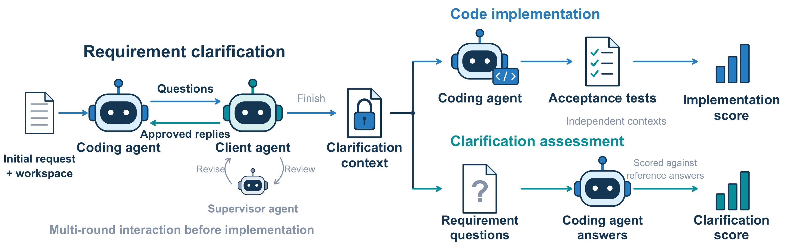
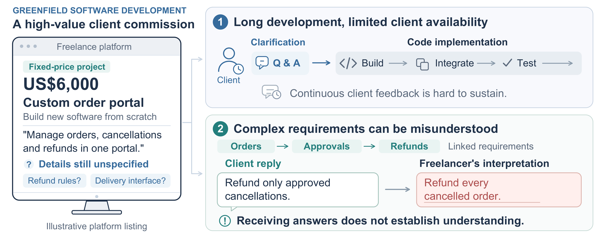
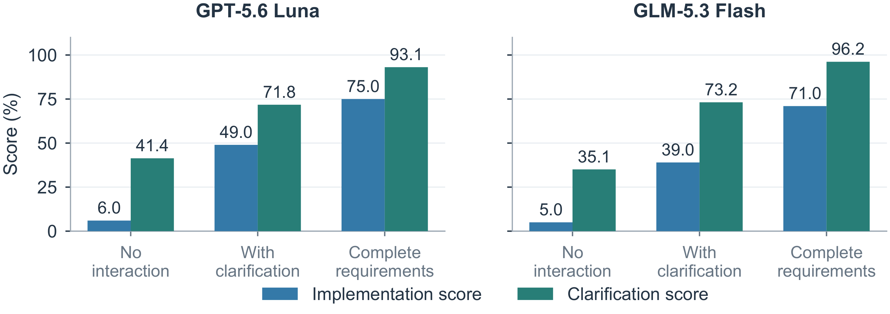
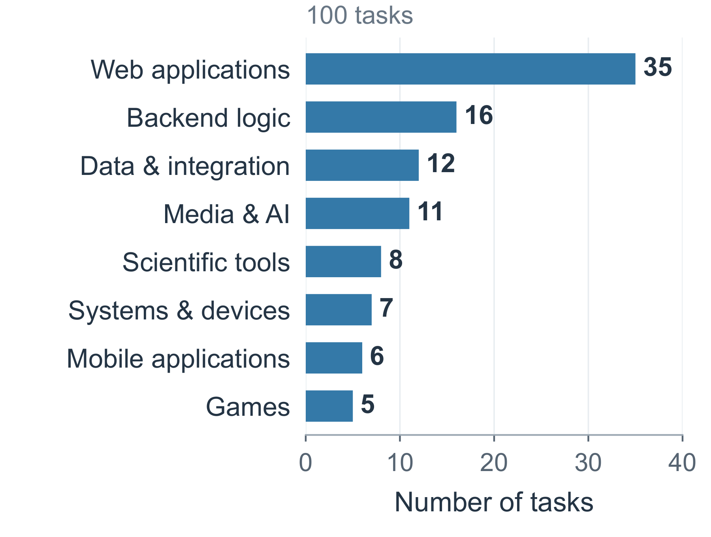

<h1 align="center">SWE-Clar</h1>

<p align="center">
  <strong>Can Coding Agents Clarify Incomplete Client Requirements and Deliver Greenfield Software?</strong>
</p>

<p align="center">
  <a href="#"></a>
  <a href="LICENSE"></a>
  <a href="https://www.python.org/"></a>
  <a href="https://nodejs.org/"></a>
  <a href="https://www.docker.com/"></a>
  
  
</p>

<p align="center">
  
</p>

## 📖 Overview

Freelance software projects usually start from an incomplete request. A coding agent has to ask the right questions, understand the answers, and then build the software without the client watching every step.

**SWE-Clar** evaluates this setting with **100 greenfield tasks** based on real software development jobs on Upwork, each worth at least US$4,000. Every task runs in three stages:

1. 💬 **Requirement clarification**: the coding agent questions a simulated client. A supervisor agent reviews each client reply before it is sent.
2. 🛠️ **Code implementation**: starting from the frozen clarification context, the agent builds the software, which is checked by hidden acceptance tests.
3. 📝 **Clarification assessment**: in a separate run with the same context, the agent answers **512 requirement questions**, which are graded against reference answers from real client–freelancer interactions.

The implementation and assessment runs are isolated, so assessment questions never guide the code.

<p align="center">
  
</p>

## 🏆 Results

Nine frontier models evaluated on all 100 tasks. Brackets show 95% task-bootstrap confidence intervals.

| Coding model | Implementation score (%) | Clarification score (%) |
| --- | ---: | ---: |
| GPT-6 Astra | **67.0** [58, 76] | **87.5** [85.0, 90.1] |
| Claude Opus 5 | <u>63.0</u> [53, 72] | 84.0 [80.9, 86.8] |
| Claude Fable 5.1 | 60.0 [50, 69] | <u>84.3</u> [81.0, 87.3] |
| GPT-5.6 Sol | 57.0 [47, 67] | 78.1 [74.9, 81.3] |
| Qwen-3.8 Max | 55.0 [45, 64] | 81.3 [77.9, 84.7] |
| GLM-5.3 | 54.0 [44, 64] | 76.8 [73.3, 80.2] |
| Kimi K3 | 49.0 [39, 59] | 76.9 [73.4, 80.3] |
| GPT-5.6 Luna | 49.0 [39, 59] | 71.8 [68.6, 74.9] |
| GLM-5.3 Flash | 39.0 [30, 49] | 73.2 [68.9, 77.3] |

Clarification matters: without client interaction, GPT-5.6 Luna drops to 6.0% and GLM-5.3 Flash to 5.0%. With complete requirements provided upfront, they reach 75.0% and 71.0%.

<p align="center">
  
</p>

## 📂 Repository layout

```text
SWE-Clar/
├── SWE-Clar/            # Benchmark dataset
│   ├── tasks/           #   100 tasks (SWECLAR-001 … SWECLAR-100)
│   └── environments/    #   Docker build recipes (Linux x86-64)
├── harness/             # Direct / Clarify / Oracle evaluation harness
├── interaction/         # Interleaved clarification and progressive Oracle
├── audit/               # Clarification-score rubric and grading client
├── validation/          # Reference, equivalent and incorrect implementations per task
├── tools/               # Dataset validation and model-config generator
└── docs/                # Evaluation guide and figures
```

Each task contains:

| Path | Purpose |
| --- | --- |
| `request.md` | The incomplete initial client request |
| `workspace/` | Synthetic starter project given to the agent |
| `environment.json` | Runtime requirements |
| `evaluation/requirement_units.yaml` | Requirement units, questions, reference answers and linked tests |
| `evaluation/tests/` | Hidden acceptance tests (never shown to the agent) |

<p align="center">
  
</p>

### Implementation controls

For every task, [`validation/`](validation/README.md) provides three implementations used to check the acceptance tests: a **reference** solution, a **behaviorally equivalent** alternative, and a **targeted incorrect** version that breaks one requirement. The reference and equivalent implementations pass all acceptance tests, while each incorrect one fails its targeted requirement. Keep these files away from the coding agent during evaluation.

## 🚀 Quick start

### 1. Install

Requires Python 3.12+ and Node.js 20.6+. The offline checks below run on any OS. Building task environments (step 3) requires a **Linux machine with an x86-64 (AMD64) CPU** and Docker, plus `npm`, `git` and `dpkg-deb`. Apple Silicon and other ARM machines are not supported for builds.

```sh
python3 -m venv .venv && . .venv/bin/activate
pip install -r harness/requirements-dev.txt
npm ci --prefix harness/pi
```

### 2. Run the offline checks (no API key needed)

```sh
python tools/validate_dataset.py
PYTHONPATH=harness python -m pytest harness/tests -q
PYTHONPATH=interaction:harness python -m pytest interaction -q
python validation/verify.py
```

### 3. Build a task environment

```sh
python SWE-Clar/environments/build.py --output ../sweclar-build --plan              # inspect the plan
python SWE-Clar/environments/build.py --output ../sweclar-build --task SWECLAR-013  # build one task
```

Omit `--task` to build all environments. Builds download public dependencies and can be large.

### 4. Configure your models

Generate a configuration for the four roles (candidate, client, supervisor and judge):

```sh
python tools/configure_model.py --api chat \
  --base-url https://YOUR_PROVIDER/v1 --model YOUR_MODEL \
  --output ../my-models.json
export SWECLAR_API_KEY=...   # never put the key in the JSON file
```

`--api` accepts `chat` (Chat Completions), `responses` (OpenAI Responses) or `claude` (Anthropic Messages). To use a different model for each role, start from [`harness/config.example.json`](harness/config.example.json) instead. The paper uses GPT-5.6 Luna with maximum reasoning as client, supervisor and judge. Changing these roles creates a different evaluation setting and should be reported.

### 5. Evaluate

```sh
# Standard benchmark (use --mode direct or --mode oracle for the control settings)
python harness/harness.py run --dataset SWE-Clar \
  --runtime-catalog ../sweclar-build/catalog.json \
  --config ../my-models.json --task SWECLAR-013 \
  --mode clarify --output ../sweclar-results/clarify-013

# Multi-cycle protocols: interleaved_clarify or progressive_oracle
SWECLAR_RUNTIME_CATALOG=../sweclar-build/catalog.json \
python interaction/run_interaction.py --release . --config ../my-models.json \
  --task SWECLAR-013 --mode interleaved_clarify \
  --output ../sweclar-results/interleaved-013
```

Keep outputs outside the dataset and do not resume a run after changing task or configuration files. A budget stop, provider refusal or incomplete evaluation counts as a failed task.

### 6. Grade the clarification answers

The clarification score is computed from the saved assessment answers in a separate grading step, using [`audit/understanding_judge.txt`](audit/understanding_judge.txt):

```sh
python audit/grade_saved_answer.py --input ../saved-ru-request.json \
  --output ../ru-judgment.json --model YOUR_JUDGE_MODEL \
  --base-url https://YOUR_PROVIDER/v1 --key-env SWECLAR_API_KEY
```

Answers are labeled correct (1), partial (0.5) or incorrect (0), averaged within each task and then across tasks. If the judge flags a conflict between reference materials, the item is rechecked rather than counted as a failure. See [`docs/EVALUATION_GUIDE.md`](docs/EVALUATION_GUIDE.md) for the full scoring workflow.

## 🗺️ Paper-to-code map

| Paper component | Entry point |
| --- | --- |
| Main results table | `harness/harness.py run --mode clarify` |
| No-interaction and complete-requirement controls | `--mode direct`, `--mode oracle` |
| Clarification score | `audit/understanding_judge.txt`, `audit/grade_saved_answer.py` |
| Acceptance tests and per-requirement outcomes | `SWE-Clar/tasks/*/evaluation/`, `harness/runtime/` |
| Interleaved clarification and progressive Oracle | `interaction/run_interaction.py`, [`interaction/PROTOCOL.md`](interaction/PROTOCOL.md) |
| Information access between roles | [`harness/CONTRACT_PROTOCOL.md`](harness/CONTRACT_PROTOCOL.md) |
| Acceptance-test validation with reference, equivalent and incorrect implementations | [`validation/`](validation/README.md) |

## 🔒 Data and privacy

All task records, contacts and fixtures are synthetic reconstructions. The repository contains no original client materials, conversations, identities or credentials. Audio fixtures are synthesized speech. Third-party dependencies keep their own license notices.

## 📄 License

Released under the [MIT License](LICENSE).

## ✍️ Citation

```bibtex
@article{li2026sweclar,
  title   = {{SWE-Clar}: Can Coding Agents Clarify Incomplete Client Requirements and Deliver Greenfield Software?},
  author  = {Li, Jialei and Wang, Dingxian and Zhao, Xiaoyan and Bai, Yimeng and Zhu, Xuanyi and Zhang, Yang and Yin, Chao and Shi, Wentao and Prabhu, Ganesh and Rajagopal, Karthik Gomadam and Levert, Brett and Yi, Darvin and Rabinovich, Andrew and Chen, Zhao},
  journal = {arXiv preprint},
  year    = {2026}
}
```
